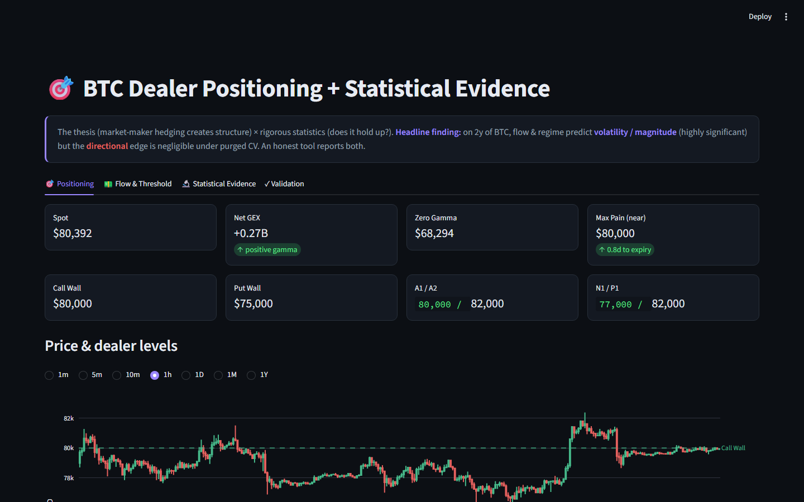
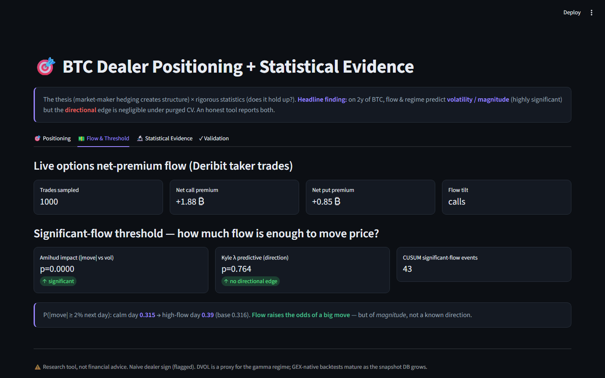
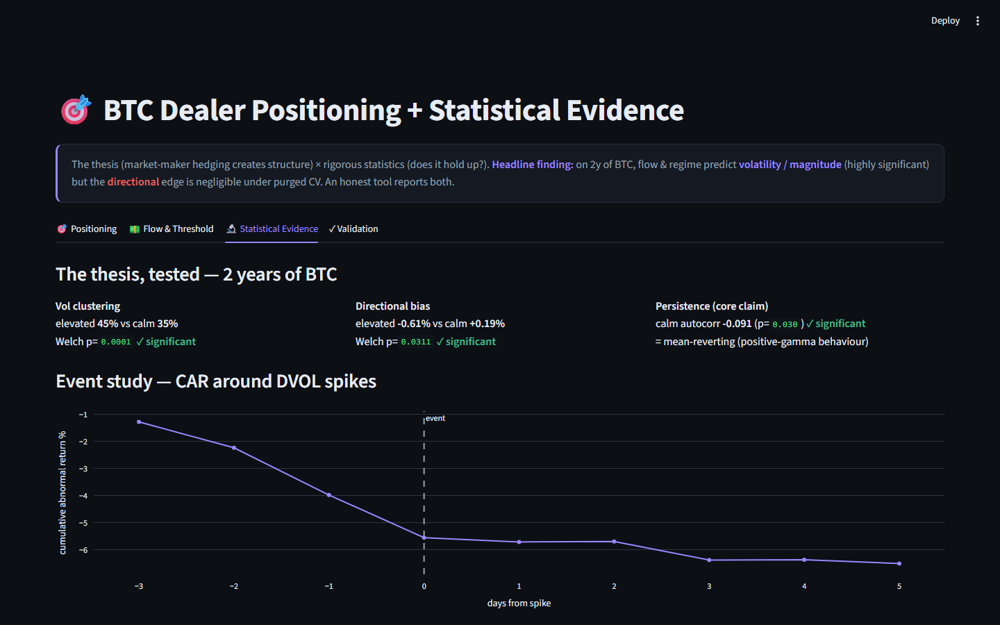

# BTC Dealer Positioning — A Statistical Test

Rebuild the "dealer gamma" positioning metrics from raw Deribit data, then test whether they predict BTC price behaviour — reporting the nulls alongside the hits.

[](https://github.com/ItamarBenEzra78/btc-dealer-positioning/actions/workflows/tests.yml)


## Executive summary

- **Dataset.** 731 daily BTC-PERPETUAL bars from Deribit's free API (2024-07-13 → 2026-07-13), the DVOL implied-volatility index, and the live option chain (open interest + mark IV per strike). The analysis sample is frozen as `data/sample_2024-07_2026-07.csv`. DVOL is available for 500 of the 731 days; after the 19-day warm-up of the trailing median, **regime tests cover 481 days (2025-03-20 onward), not 731.**
- **Question.** A popular retail options-positioning thesis holds that dealer hedging shapes the tape: positive-gamma regimes are calm and mean-reverting, negative-gamma regimes trend, and large flow precedes large moves. Using the implied-vol regime as an observable proxy, which of those claims survive a specific statistical test?
- **Method.** Every headline metric (GEX, walls, zero-gamma, max pain) is recomputed from the raw chain with Black-Scholes gamma. Each claim becomes a test: Welch / Mann-Whitney / Levene two-sample tests, a permutation test, lag-1 autocorrelation on contiguous same-regime pairs, an event study with a 60-day pre-event benchmark, GARCH(1,1), a two-state Markov-switching model in R, and an expanding-window walk-forward validation with a horizon-length gap before each test block.
- **Main result.** The **magnitude** of moves is predictable: forward 3-day realized vol is 45.3% in elevated-vol regimes vs 27.5% in calm ones (Welch p < 0.0001). **Direction is not**: an uncalibrated logistic regression on regime features scores a walk-forward Brier of 0.1869 vs 0.1915 for the base rate (edge +0.005, within noise). **Explicit null:** an earlier version reported "calm tapes mean-revert" (autocorr −0.091, p = 0.03); after correcting regime labelling for missing DVOL (days without DVOL had been labelled *calm*) the effect is **not significant** (−0.034, p = 0.55).

## Dashboard

Screenshots from the Streamlit app running locally against live Deribit data (2026-09-06).

| View | What it shows |
|---|---|
|  | **Positioning** — spot, Net GEX, zero-gamma, call/put walls, max pain, A/P/N zones, price chart with dealer levels, live pin-condition check. Falls back to the last stored snapshot if Deribit is unreachable. |
|  | **Flow & Threshold** — net options premium flow, Kyle λ, volume–volatility regression, CUSUM events, and the in-sample significant-threshold model `P(|move| ≥ 2%)`. |
|  | **Statistical Evidence** — regime two-sample tests, persistence, DVOL-spike event study, Markov regime probability, and the walk-forward verdict (gap vs no gap). |

The Validation tab compares the engine to the CryptoGamma oracle; that endpoint has returned HTTP 401 since 2026-09, so the tab shows "Oracle unavailable" (see Limitations).

## Findings

Every number is printed by `python3 stats_spine.py`, `python3 flow_engine.py` or `Rscript inference.R` on the frozen sample, and asserted by `tests/test_engines.py`.

| Question | Method | Result | Verdict |
|---|---|---|---|
| Do elevated-vol regimes have higher forward realized vol? | Welch's t, Mann-Whitney U, Levene, permutation (n 169 / 309) | **45.3%** vs **27.5%**; all p < 0.0001 | **Supported** — vol clustering is strong. |
| Is volatility clustering persistent? | GARCH(1,1), `arch` | α = 0.107, β = 0.845, persistence **0.952** | **Supported.** |
| Do two volatility regimes exist? | Markov switching, R `MSwM` | low-vol +0.13%/day (sd 1.55%, stay 0.94); high-vol −0.28%/day (sd 3.59%, stay 0.87) | **Supported** — two sticky regimes. |
| Does the regime carry a directional bias over 3 days? | Welch's t on `fwd_ret_3` | elevated **−0.61%** vs calm **+0.05%**, p = **0.081** | **Not significant.** |
| Do calm tapes mean-revert, elevated tapes trend? | lag-1 autocorrelation, contiguous pairs | calm **−0.034** (p = 0.55, 298 pairs); elevated **+0.023** (p = 0.77, 156 pairs) | **Null** — the previously reported calm-regime effect was a labelling bug. |
| Do DVOL spikes coincide with drawdowns? | event study, 24 events, 60-day pre-event benchmark | CAR(−3 … +5) = **−5.3%**; the drop is concentrated on days −3 … 0 (t ≈ −2.0 to −2.1) | **Descriptive** — spikes follow losses; windows overlap, so t-stats are optimistic. |
| Does high volume raise the odds of a large move? | in-sample logistic on volume z-scores | P(\|move\| ≥ 2% next day): **0.315** on a calm day → **0.390** at z = +3 (base 0.316) | **Supported in-sample** — magnitude, not direction. |
| Does signed flow predict tomorrow's return? | predictive Kyle λ (OLS) | p = **0.76**, R² = 0.000 | **Null.** |
| Does the regime predict direction out of sample? | expanding-window walk-forward, 5 folds, OOS n = 395, uncalibrated `LogisticRegression` | gap = 3: Brier **0.1869** vs base **0.1915** (edge +0.0046); gap = 0: Brier **0.1927** (edge −0.0012) | **Null** — negligible either way; the gap did not change the verdict. |
| Do reconstructed levels match an external oracle? | side-by-side vs CryptoGamma, logged 2026-07-13 | call wall $65,000 on both sides; spot and max pain within tolerance | **Matched then** — not reproducible since the endpoint went 401. |

## Architecture

```mermaid
flowchart LR
    D[Deribit REST<br/>options · OHLC · DVOL] --> DL[data_layer.py]
    DL --> CSV[(data/market_daily.csv)]
    DL --> DB[(SQLite / Postgres<br/>db.py)]
    DL --> SNAP[(data/snapshots/*.jsonl)]
    WK[worker.py<br/>APScheduler] --> DL
    D --> PS[positioning.py<br/>gex_engine.py]
    D --> FLV[flow_engine.live_option_flow]
    CSV --> SS[stats_spine.py]
    CSV --> PH[phenomenon.py]
    CSV --> FL[flow_engine.py<br/>backtestable part]
    CSV --> RI[inference.R<br/>MSwM]
    RI --> RO[(data/r_regime.csv<br/>r_regime_summary.json)]
    DB --> API[api.py<br/>FastAPI]
    PS --> API
    SS --> DASH[dashboard.py<br/>Streamlit]
    RO --> DASH
    PS --> DASH
    FLV --> DASH
    SNAP -. fallback .-> DASH
    CG[CryptoGamma oracle] -. validate.py .-> DASH
```

The committed CSV feeds the statistics (`stats_spine.py`, `phenomenon.py`, `inference.R`); the database feeds the API and is filled by the worker. The dashboard reads the CSV and the R outputs directly and only touches the live engines for the Positioning and Flow tabs.

## What this demonstrates

- **Hand-rolled statistics, where the library would hide the point:** the walk-forward split generator and gap logic, the permutation test, the event study (abnormal returns vs a pre-event window), the contiguous-pair autocorrelation, the two-proportion z-test in `phenomenon.py`, Black-Scholes gamma, max pain and the zero-gamma search.
- **Library statistics, used as intended:** `scipy.stats` (Welch, Mann-Whitney, Levene, OLS), `scikit-learn` (`LogisticRegression`, `StandardScaler`, `CalibratedClassifierCV`, `brier_score_loss`, `calibration_curve`), `arch` (GARCH), R `MSwM` (Markov switching).
- **Leak-aware validation:** the gap is derived from the target's horizon and a mismatch raises; the test suite proves `max(train) + horizon < min(test)` for every fold and shows, with a memorising model on synthetic data, that the gap removes the fake skill produced by overlapping labels.
- **Reporting discipline:** the correction of the regime-label bug is recorded in the findings table rather than silently absorbed; the gap/no-gap Brier pair is printed so the "purging" claim is an artefact, not a slogan.
- **Plumbing:** SQLAlchemy 2.0 repository, APScheduler collector, FastAPI with Pydantic contracts, Streamlit dashboard with offline fallbacks, systemd units, CI with lint + tests on Python 3.9–3.12.

## Reproduce

```bash
pip install -r requirements-dev.txt
python3 stats_spine.py        # every number in the Findings table (Python side)
python3 flow_engine.py        # Kyle λ, Amihud, volume–volatility OLS, CUSUM, threshold model
python3 phenomenon.py         # the reusable battery on three example event masks
Rscript inference.R           # Markov switching -> data/r_regime.csv + r_regime_summary.json (needs MSwM)
streamlit run dashboard.py    # dashboard (works offline from committed data)
```

`python3 run_all.py` runs the full pipeline, including live fetches. It **overwrites** `data/market_daily.csv`, `data/r_regime.csv`, `data/r_regime_summary.json`, appends to `data/snapshots/snapshots.jsonl` (git-ignored) and writes `data/app.db`. It does **not** touch `data/sample_2024-07_2026-07.csv`, which is what the tests and the documented numbers use. The dashboard reads `market_daily.csv`, so its figures move with a refresh; the documented ones do not.

Only `numpy`, `pandas`, `scipy`, `scikit-learn` and `arch` are needed for the statistics; Streamlit, FastAPI, SQLAlchemy and APScheduler are for the app layer. Postgres is an optional extra (`pip install "psycopg[binary]"`, set `DATABASE_URL`).

## Tests

```bash
python3 -m pytest -q     # 35 tests
ruff check .
```

Pure-function tests cover the maths (gamma, max pain, zero-gamma with a closed-form answer, forward returns, regime labelling with missing DVOL, CUSUM, instrument parsing, a synthetic event study). Walk-forward tests prove no train/test overlap for n ∈ {100, 477, 731} × horizon ∈ {1, 3, 7}, that a horizon mismatch raises, and the leak canary above. Data-backed tests assert the Findings numbers on the frozen sample. An offline Streamlit `AppTest` renders the dashboard with every network call failing.

## Limitations

- **DVOL coverage.** The regime label exists for 481 of 731 days. All regime-conditioned results are statements about 2025-03-20 → 2026-07-13.
- **DVOL is a proxy** for the dealer-gamma regime. The GEX-conditioned test needs the snapshot history the worker is accumulating; it does not exist yet.
- **Overlapping event windows.** 24 DVOL spikes in 481 days means several ±3/+5-day windows overlap, so event-study t-statistics are optimistic.
- **Overlapping forward windows** make the in-sample p-values optimistic in general; the walk-forward Brier is the number to trust for anything predictive.
- **The threshold model is in-sample.** `P(|move| ≥ 2%)` comes from a logistic fit on the whole sample; it describes the sample, it is not a validated forecast.
- **Headline Brier is uncalibrated.** The walk-forward uses a plain scaled `LogisticRegression`; the sigmoid-calibrated single-split estimate (`[5]` in `stats_spine.py`) is a diagnostic, not the headline.
- **Oracle offline.** The CryptoGamma public endpoint has returned HTTP 401 since 2026-09; the validation row records a comparison logged on 2026-07-13 and cannot currently be re-run.
- **Naive dealer sign** (long calls / short puts). The net-gamma sign can disagree with other vendors while the levels agree.
- Not financial advice.

## License

MIT — see [`LICENSE`](LICENSE). Further reading: [`docs/CASE_STUDY.md`](docs/CASE_STUDY.md), [`docs/METHODOLOGY.md`](docs/METHODOLOGY.md), [`docs/DEPLOYMENT.md`](docs/DEPLOYMENT.md).
